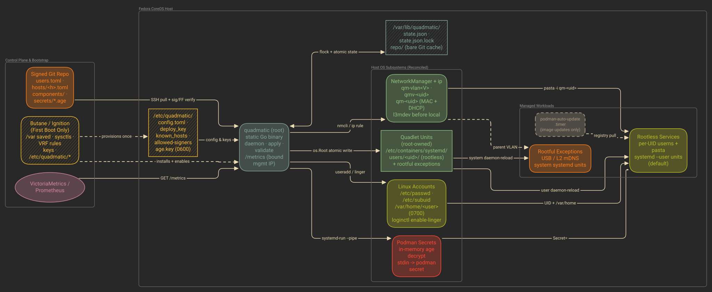

# quadmatic

A pull-based, single-binary Go GitOps agent for **Fedora CoreOS** that deploys **Podman Quadlets** end to end. This includes the unprivileged Linux user accounts, deterministic `subuid`/`subgid` ranges, systemd linger state, per-quadlet VLAN/VRF/`macvlan` virtual interfaces, and `age`-encrypted Podman secrets that rootless services need.



---

## Why quadmatic?

Podman Quadlet intentionally does not support running a rootless unit via `User=` or `DynamicUser=`. Getting a rootless service running on Fedora CoreOS requires creating a dedicated user, configuring `subuid`/`subgid`, enabling linger, placing units into `/etc/containers/systemd/users/<uid>/`, provisioning user-owned Podman secrets, and wiring networking.

`quadmatic` automates that entire lifecycle from a signed Git repository without requiring layered RPMs, python for Ansible, or other package dependencies.

- **Rootless by default**: each service runs under its own pinned UID (`>= 1000`, never reused) with root-owned quadlets in `/etc/containers/systemd/users/<uid>/` and isolated `/var/home/<user>` storage. Rootful execution (`rootful = true`) is an explicit, documented exception.
- **Survives reprovisioning**: paired with a preserved `/var` partition (`wipe_filesystem: false`), pinned UIDs and deterministic `subuid`/`subgid` mappings preserve file ownership across OS reinstalls, and `quadmatic` automatically recreates missing accounts, quadlets, and Podman secrets.
- **VLAN-agnostic hosts**: give a CoreOS node a trunk NIC; individual rootless quadlets can attach to arbitrary 802.1Q VLANs with pinned MAC addresses for DHCP static leases via isolated Linux VRFs (`qmv-<uid>`), `macvlan` (`qm-<uid>`), `l3mdev`-before-`local` policy routing, and hardened `pasta` flags—without putting host IPs or routes on service VLANs.
- **Cryptographically verified, pull-only GitOps**: pulls over SSH (`StrictHostKeyChecking=yes`, pinned `known_hosts`), enforces SSH commit signatures (`allowed-signers`), and requires fast-forward history (with an explicit break-glass override).
- **Safe to operate**: offline `validate`, zero-mutation `--dry-run` plans, drift auto-healing, minimal-disruption restarts, cross-process `flock`, Go `os.Root` symlink-proof rootless file I/O, and transactional rollback on Stage 7 failures.
- **Observable**: built-in Prometheus `/metrics` endpoint bound strictly to an explicit management IP (never wildcard).

> For the full deep-dive (reconcile lifecycle, transactional rollback, VRF networking, security model, and package-by-package tree), see **[docs/architecture.md](docs/architecture.md)**.

---

## Quick Start

### Build a Static Binary

Requires Go 1.26+.

```bash
CGO_ENABLED=0 go build -o quadmatic ./cmd/quadmatic
```

### Run Tests

```bash
go test -race ./...
go vet ./...
```

---

## Git Repository Layout

Your fleet Git repository declares users, hosts, components, templates, config files, and `age`-encrypted secrets. Example:

```text
fleet-repo/
├── users.toml                        # Fleet-wide append-only user registry (name -> pinned UID)
├── hosts/
│   ├── services-01.toml              # Components assigned to this host + host vars/overrides
│   └── services-02.toml
│   └── services-03.toml
├── components/
│   ├── open-webui/
│   │   ├── component.toml            # Ports, default network, secrets, file mode overrides
│   │   ├── open-webui.container.tmpl # Go text/template (missingkey=error)
│   │   ├── open-webui.volume
│   │   └── files/                    # Config files mounted into the service
│   ├── caddy/
│   └── frigate/
│   └── littleboxes/
│   └── unkanny/
│   └── prometheus/
│   └── grafana/
└── secrets/
    └── open-webui-secret-key.age     # Encrypted to target host age/SSH-ed25519 key(s)
```

### Example Manifests

**`users.toml`** (fleet-wide; UIDs are append-only and never reused):

```toml
[subid]
base = 1000000
uid_base = 2000
count = 65536
# Formula: start = base + (uid - uid_base) * count

[users.openwebui]
uid = 2001

[users.caddy]
uid = 2002
```

**`hosts/services-02.toml`**:

```toml
hostname = "services-02"

[vars]
listen_addr = "10.0.3.12"

[[component]]
name = "open-webui"
user = "openwebui"

# Optional: attach this rootless component to a dedicated VLAN + pinned MAC (DHCP)
[component.network]
vlan = 30
mac = "02:51:4d:00:07:d1"
macvlan_mode = "private"              # "private" (default) or "bridge"
dns = ["10.0.30.1"]                   # explicit VLAN DNS, or set dns_from_dhcp = true
tcp_ports = ["8080:8080"]
udp_ports = []
ipv6 = false

[[component]]
name = "caddy"
user = "caddy"

[[component]]
name = "frigate"
rootful = true
reason = "USB Coral passthrough"
```

**`components/open-webui/component.toml`**:

```toml
[ports]
http = { port = 8080, protocol = "tcp" }

[secrets]
webui_secret_key = "secrets/open-webui-secret-key.age"

[files."config.yaml"]
mode = "0600"
```

**`components/open-webui/open-webui.container.tmpl`**:

```ini
[Container]
Image=ghcr.io/open-webui/open-webui:main
AutoUpdate=registry
Network={{ .Net.PastaArgs }}
{{- range .Net.DNS }}
DNS={{ . }}
{{- end }}
Secret=webui_secret_key,type=env,target=WEBUI_SECRET_KEY
Volume=open-webui.volume:/app/backend/data
```

---

## Host Configuration (`/etc/quadmatic/config.toml`)

Host-local settings are provisioned once via Butane so Git manifests stay hardware-agnostic across nodes:

```toml
hostname = "services-02"                           # optional; defaults to os.Hostname()
repo_url = "git@git.example.lan:homelab/fleet.git"
branch = "main"
poll_interval = "5m"
ssh_key = "/etc/quadmatic/deploy_key"              # 0600 root:root read-only deploy key
ssh_known_hosts = "/etc/quadmatic/known_hosts"     # pinned Git server host keys
allowed_signers = "/etc/quadmatic/allowed-signers" # SSH public keys allowed to sign commits
allow_non_ff = false                               # break-glass for validly signed non-FF tips
age_identity = "/etc/quadmatic/age.key"            # 0600 root:root native age or SSH ed25519 key
trunk_interface = "enp3s0"                         # physical NIC carrying tagged VLANs
metrics_listen = "10.0.3.12:9100"                  # explicit management IP; empty disables /metrics
state_file = "/var/lib/quadmatic/state.json"
repo_dir = "/var/lib/quadmatic/repo"
```

---

## CLI Usage

```bash
# Offline validation (CI or laptop): checks manifests, collisions, templates, and quadlet --dryrun
quadmatic validate --repo-path ./fleet-repo
quadmatic validate --repo-path ./fleet-repo --host services-02

# Dry-run plan against remote repo (zero writes to live Git cache or host)
sudo quadmatic apply --config /etc/quadmatic/config.toml --dry-run

# One-shot apply (or local checkout apply for testing)
sudo quadmatic apply --config /etc/quadmatic/config.toml
sudo quadmatic apply --config /etc/quadmatic/config.toml --repo-path ./fleet-repo

# Emergency break-glass for a validly signed non-fast-forward tip (signatures still enforced)
sudo quadmatic apply --config /etc/quadmatic/config.toml --allow-non-ff

# Run the long-running systemd daemon (internal ticker + SIGHUP trigger + bound /metrics)
sudo quadmatic daemon --config /etc/quadmatic/config.toml
```

Trigger an immediate reconcile on a running daemon with `sudo systemctl reload quadmatic` (sends `SIGHUP`).

---

## Deployment & Operations

- **Butane bootstrap:** [deploy/butane/node.bu.tmpl](deploy/butane/node.bu.tmpl): reference Fedora CoreOS Butane v1.5 config with preserved `/var`, sysctls, `quadmatic-vrf-rules.service`, `quadmatic.service`, and `podman-auto-update.timer`.
- **Systemd service unit:** [deploy/systemd/quadmatic.service](deploy/systemd/quadmatic.service)
- **Migration runbook:** [deploy/migration/services-02-openwebui.md](deploy/migration/services-02-openwebui.md): adopting an existing rootless user and volume without data loss.
- **FCOS VM verification script:** [scripts/fcos-spike.sh](scripts/fcos-spike.sh): validates VRF + `macvlan` + `l3mdev`-before-`local` + `pasta` isolation, linger, D-Bus, and rootless Podman secret piping on a live Fedora CoreOS VM.

---

## Observability

When `metrics_listen` is configured, `quadmatic daemon` serves `GET /metrics` on that explicit IP with:

- `quadmatic_last_sync_timestamp_seconds`
- `quadmatic_last_sync_success`
- `quadmatic_sync_duration_seconds`
- `quadmatic_applied_info{sha, hostname}`
- `quadmatic_managed_units{scope}`
- `quadmatic_failed_units{user, unit}`
- `quadmatic_drift_detected`
- `quadmatic_rollbacks_total`
- `quadmatic_reconcile_errors_total{stage}`

---

## Reusable `pkg/users` Package

`pkg/users` has no dependencies on `internal/` and can be imported independently by other Go tools that need idempotent pinned-UID account creation/adoption, deterministic `subuid`/`subgid` reconciliation with overlap validation, and `loginctl enable-linger` management on Fedora CoreOS.
