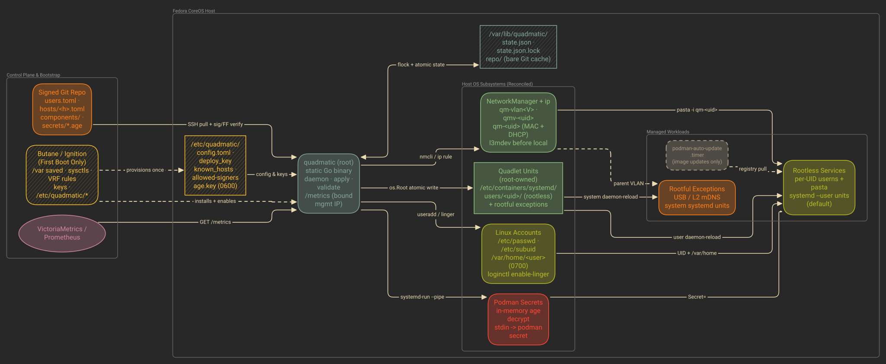
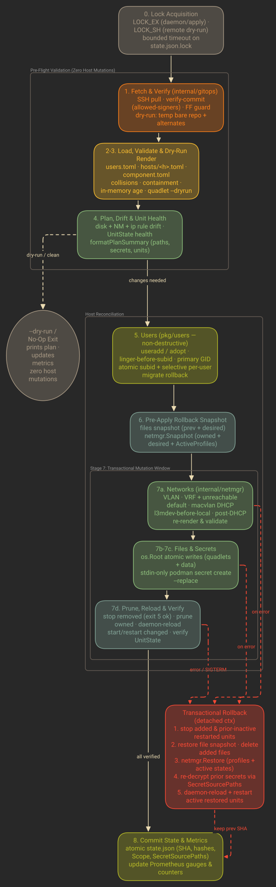
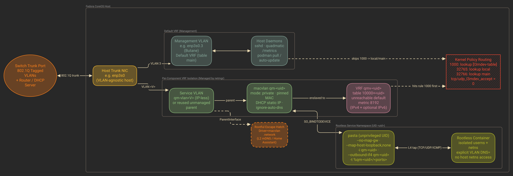
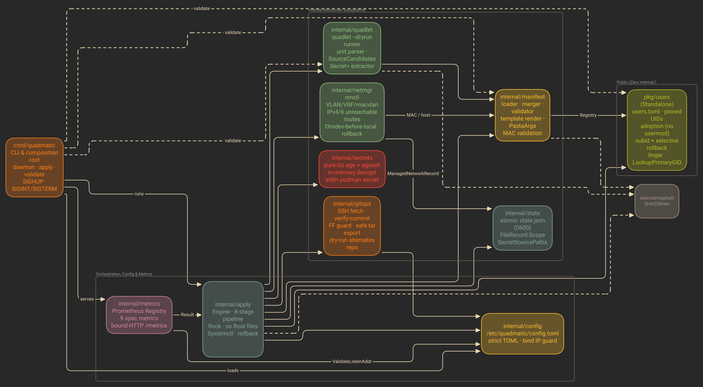

# quadmatic Architecture

`quadmatic` is a pull-based, single-binary Go GitOps agent for **Fedora CoreOS (FCOS)** that deploys **Podman Quadlets** end to end—managing pinned-UID Linux service accounts, deterministic `subuid`/`subgid` ranges, systemd linger, per-quadlet VLAN/VRF/`macvlan` virtual interfaces with DHCP static leases, `age`-encrypted Podman secrets, drift auto-healing, and transactional rollback.

> All architecture diagrams in this document are generated with [`littleboxes`](https://github.com/) using the `gruvbox-dark` theme. Each diagram ships with its editable `.lbx` drawing, `.yaml` source spec, and `.svg` render under `docs/diagrams/`.

---

## 1. Core Design Principles & Invariants

1. **Rootless by default.** Every service runs under its own pinned unprivileged UID (`>= 1000`, never reused) with isolated `/var/home/<user>` storage, user namespace, and user-owned Podman secrets. Rootful execution (`rootful = true`) requires an explicit `reason` and is reserved for hardware/L2 exceptions (USB Coral passthrough, mDNS discovery).
2. **Survives node reprovisioning.** Paired with a preserved `/var` partition (`wipe_filesystem: false`), pinned UIDs and deterministic `subuid`/`subgid` ranges ensure a reinstalled FCOS node boots up with matching ownership across all persistent volumes, data directories, and Podman storage—and `quadmatic` automatically recreates missing accounts, quadlets, and Podman secrets on the first reconcile pass.
3. **VLAN-agnostic hosts.** Nodes only require a physical trunk NIC and a management VLAN. Individual rootless quadlets can attach to arbitrary VLANs with pinned MAC addresses for DHCP static reservations via isolated Linux VRFs and `pasta`, without assigning host IPs or routes on service VLANs.
4. **Pull-only & cryptographically verified.** No inbound admin API. `quadmatic` pulls over SSH (`StrictHostKeyChecking=yes`, pinned `known_hosts`), enforces SSH commit signatures (`allowed-signers`), and rejects non-fast-forward history unless an explicit break-glass override (`--allow-non-ff` / `allow_non_ff = true`) is set.
5. **Validate before mutating, roll back on failure.** All manifest checks, collision checks, path/symlink containment checks, in-memory `age` decryption, template rendering, and `/usr/libexec/podman/quadlet --dryrun` validation complete before any host resource is touched. Any failure during Stage 7 mutations triggers a bounded, cancellation-shielded transactional rollback.
6. **Zero non-FCOS host dependencies.** Compiled as a static `CGO_ENABLED=0` Go binary using pure-Go `filippo.io/age` and standard FCOS OS binaries (`git`, `ssh`, `useradd`, `loginctl`, `systemctl`, `podman`, `/usr/libexec/podman/quadlet`, `nmcli`, `ip`).

---

## 2. High-Level System Architecture



*Diagram sources:* [system-overview.yaml](diagrams/system-overview.yaml) · [system-overview.lbx](diagrams/system-overview.lbx)

### Split of Responsibilities

| Layer | Lifecycle | Owns |
| --- | --- | --- |
| **Butane / Ignition** | First boot only | Partitioning (separate preserved `/var`), SSH keys, trunk NIC + management VLAN, sysctls (`ip_unprivileged_port_start=80`, `tcp/udp_l3mdev_accept=0`), `quadmatic-vrf-rules.service`, installing `/usr/local/bin/quadmatic` (SHA-256 verified), `/etc/quadmatic/*` credentials, enabling `quadmatic.service` and `podman-auto-update.timer`. |
| **`quadmatic`** | Continuous (`poll_interval` + `SIGHUP`) or one-shot `apply` | Reconciling desired state from Git: accounts (`pkg/users`), NetworkManager VLAN/VRF/`macvlan` profiles & `ip rule` hardening (`internal/netmgr`), root-owned quadlets & `os.Root`-confined data files (`internal/apply`), Podman secrets (`internal/secrets`), minimal-disruption unit restarts, scoped pruning, drift auto-heal, and Prometheus `/metrics`. |
| **`podman-auto-update.timer`** | Periodic (host systemd) | Container image updates (`AutoUpdate=registry`) over the host's management network. `quadmatic` manages configuration, never image tags/pulls. |

### Trust & Ownership Boundaries

- **Root-owned quadlet directories:** Rootless quadlets are installed into `/etc/containers/systemd/users/<uid>/` (`0644`, `root:root`) rather than user-writable `~/.config/containers/systemd/`. Service users cannot tamper with their own unit definitions, `pasta` flags, or `Secret=` bindings.
- **Strict ownership scoping:** `quadmatic` tracks every file, generated unit, Podman secret, and `qm-*`/`qmv-*` NetworkManager profile it creates in `/var/lib/quadmatic/state.json` (`0600`). Hand-placed files, unmanaged NetworkManager connections (including reused management VLANs), and non-managed Podman secrets are never modified or pruned.
- **Never deletes users or persistent data:** Decommissioned service accounts are logged as warnings; their units are stopped and pruned, while `/etc/passwd`, `/etc/subuid`, `/etc/subgid`, and `/var/home/<user>` remain untouched.

---

## 3. Reconciliation Lifecycle & Transactional Rollback



*Diagram sources:* [reconcile-pipeline.yaml](diagrams/reconcile-pipeline.yaml) · [reconcile-pipeline.lbx](diagrams/reconcile-pipeline.lbx)

### Stage-by-Stage Walkthrough

- **Stage 0 — Lock Acquisition (`internal/apply/lock.go`):** Mutating passes (`daemon` ticks and `apply`) acquire an exclusive non-blocking polling `flock` (`LOCK_EX`) on `<state_file>.lock` with a bounded `LockTimeout` (default `2m`). Remote `--dry-run` passes acquire a shared `LOCK_SH` so dry runs never race against daemon fetches/repacks while allowing concurrent dry runs.
- **Stage 1 — Fetch & Verify (`internal/gitops`):** Pulls `+refs/heads/<branch>:refs/remotes/origin/<branch>` over SSH (`GIT_ALLOW_PROTOCOL=ssh:file`, `StrictHostKeyChecking=yes`, pinned `known_hosts`), verifies the commit's SSH signature against `allowed-signers`, enforces `git merge-base --is-ancestor` fast-forward history (unless break-glass is enabled), and exports a clean tree via `git archive` with hardened tar/symlink extraction. Remote `--dry-run` fetches into an ephemeral bare repo linked via `objects/info/alternates`, making zero writes to `/var/lib/quadmatic/repo`.
- **Stages 2–3 — Load, Validate & Dry-Run Render (`pkg/users`, `internal/manifest`, `internal/secrets`, `internal/quadlet`):**
  - Loads `users.toml`, `hosts/<hostname>.toml`, and referenced `components/<name>/component.toml`.
  - Runs static checks: UID uniqueness & `uint32` bounds, `subuid`/`subgid` non-overlap against all host entries, `rootful`/`reason` validation, default-VRF `(ip, port, proto)` collision checks, unicast MAC uniqueness, quadlet filename uniqueness per scope, and strict repo-root path/symlink containment.
  - Decrypts all referenced `.age` secrets purely in memory (`filippo.io/age` + `agessh`), resolves primary GIDs and existing VLAN parents/DHCP DNS, renders `.tmpl` files (`missingkey=error`), and runs `/usr/libexec/podman/quadlet --dryrun` per scope to validate syntax and capture deterministic SHA-256 hashes + `Secret=` references.
- **Stage 4 — Plan, Drift Detection & Unit Health (`internal/apply`):**
  - Diffs desired files, secrets, generated unit hashes, NetworkManager profiles, VRF routes, and `ip rule` ordering against both `state.json` and live host state.
  - Queries existing units via `UnitState` (`ActiveState`, `Type`, `Result`): skips querying users pending `CreateUser` (reporting them `inactive` so reprovisioning and deleted-user recovery never wedge Stage 5), excludes healthy completed `Type=oneshot` units (`inactive` + `Result=success`) from `quadmatic_failed_units`, and keeps non-context query errors out of `priorNonActive` so transient D-Bus glitches cannot cause rollback to stop running services.
  - Prints a detailed plan (paths, healed markers, secrets, unit actions) and exits cleanly on `--dry-run` or converged no-op ticks.
- **Stage 5 — Users (`pkg/users`):** Non-destructively creates missing accounts (`/var/home/<user>`, `0700`, `nologin`) or adopts existing accounts matching `(name, uid)` without ever invoking `usermod`. For adopted users, enables linger before updating `/etc/subuid`/`/etc/subgid` and performs selective per-user subid rollback if `podman system migrate` fails partway through a batch. Re-resolves actual primary GIDs from `/etc/passwd` and re-renders if any newly created user's GID differs from its UID.
- **Stage 6 — Pre-Apply Snapshot:** Captures on-disk file snapshots (for both `prevState.Files` and `plan.desiredFiles`) and `netmgr.Snapshot` (capturing live profile definitions and `ActiveProfiles` for both `prevState.Networks` and desired managed profiles so adopted live profiles are never deleted on rollback).
- **Stage 7 — Transactional Mutation Window:**
  - **7a. Networks (`internal/netmgr`):** Reconciles VLANs, per-UID VRFs (`unreachable default metric 8192`), `macvlan` profiles, and `l3mdev`-before-`local` `ip rule` ordering; polls DHCP DNS for `dns_from_dhcp = true` components, re-rendering and re-validating with `quadlet --dryrun` if DNS changed; marks components with mutated network profiles dirty so `pasta` units restart.
  - **7b–7c. Files & Secrets:** Atomically writes quadlets and `os.Root`-confined data files; upserts changed Podman secrets (plus all secrets for any `CreateUser` scope) via `stdin` only.
  - **7d. Prune, Reload & Verify:** Stops removed units (treating systemd exit 5 = not loaded as a no-op), prunes tracked files/secrets/NM profiles, runs `daemon-reload` per affected scope, starts new units and restarts only units with changed generated unit hash, source quadlet, owning component data file, referenced secret, or mutated network profile, and verifies every started/restarted unit reaches `active` (or `Type=oneshot` `inactive` + `Result=success`).
- **Transactional Rollback (on any Stage 7 failure or `SIGINT`/`SIGTERM`):** Executes under `context.WithTimeout(context.WithoutCancel(ctx), rollbackTimeout)` (default `60s`), accumulating errors with `errors.Join`:
  1. Stops newly added units (reverse helper order) and any previously-inactive (`priorNonActive`) units that Stage 7d restarted.
  2. Restores snapshotted files and deletes newly created files.
  3. Calls `netmgr.Restore`: deletes newly created `qm-*` profiles not in the snapshot (`macvlan -> vrf -> vlan`), restores snapshotted profile properties (`vlan -> vrf -> macvlan`), brings up previously-active profiles, and unconditionally brings down previously-inactive profiles (`macvlan -> vrf -> vlan`).
  4. Removes newly added Podman secrets and re-decrypts modified/pruned secrets directly from `prevState.AppliedSHA` using `prevState.SecretSourcePaths` (cleanly skipped on bootstrap when `AppliedSHA == ""`).
  5. Runs `daemon-reload` on reloaded scopes, restarts previously-active mutated units, queries post-rollback unit health for `quadmatic_failed_units`, and leaves `state.json` pinned at `prevState.AppliedSHA`.
- **Stage 8 — Commit State & Metrics:** Atomically writes `state.json` (`0600`) with the new SHA, file records (including `Scope`), generated unit hashes, secret digests + `SecretSourcePaths`, and managed network records, then updates Prometheus metrics.

---

## 4. Rootless Per-Quadlet Networking (Option 2B)



*Diagram sources:* [network-isolation.yaml](diagrams/network-isolation.yaml) · [network-isolation.lbx](diagrams/network-isolation.lbx)

`quadmatic` supports two complementary networking models per component:

1. **Default-VRF Host-Port Mode:** Components declare `[ports]` in `component.toml` (overridable in `hosts/<hostname>.toml`, with shorthand `port = 8080` inheriting `protocol` and `host_ip`). `manifest.Validate` enforces `(ip, port, proto)` uniqueness across all default-VRF components and exposes `.Host.Components` so reverse proxies like Caddy can generate upstream configs from the manifest.
2. **Per-Component Virtual Interface Mode (`[component.network]`):**
   - **VLAN Parent Resolution:** Reuses any existing unmanaged VLAN interface on `trunk_interface` (e.g., Butane's management `enp3s0.3`) with `Owned = false` so it is never modified or pruned; otherwise creates an IP-less `qm-vlan<V>` (max 11 chars).
   - **Per-UID VRF (`qmv-<uid>`, max 10 chars):** Bound to routing table `10000 + uid` with a static `unreachable default metric 8192` fallback route (IPv4, plus IPv6 when `ipv6 = true`) so loss of DHCP fails closed (`ENETUNREACH`) and never falls through to `main`.
   - **Per-UID `macvlan` (`qm-<uid>`, max 9 chars):** Enslaved to `qmv-<uid>` (`connection.port-type = vrf`), defaults to `macvlan.mode = private` (preventing same-host/same-VLAN hairpinning past the external firewall), clones the component's pinned unicast MAC for DHCP static reservations, and sets `ignore-auto-dns = yes` so container VLAN DHCP never overwrites host `/etc/resolv.conf`.
   - **Kernel Policy Routing (`l3mdev` before `local`):** `netmgr` (and `quadmatic-vrf-rules.service` at boot) adds `prio 32765 table local` before surgically deleting `prio 0 table local` (for IPv4, and IPv6 when used), while verifying `net.ipv4.tcp_l3mdev_accept == 0` and `udp_l3mdev_accept == 0`. Every VRF-bound socket hits rule `1000: lookup [l3mdev-table]` first and never leaks into the host's `local` or `main` tables, while non-VRF host traffic (`sshd`, `/metrics`, `podman pull`, `podman-auto-update`) skips rule `1000` and routes normally.
   - **Hardened `pasta` Binding:** `.Net.PastaArgs` emits `pasta:--no-map-gw,--map-host-loopback,none,--ipv4-only,-i,qm-<uid>,--outbound-if4,qm-<uid>,-t,%qm-<uid>/<ports>` (switching to dual-stack + `--outbound-if6` when `ipv6 = true`), binding inbound and outbound L4 traffic directly to `qm-<uid>` without hardcoding IPs in Git.
   - **Rootful Escape Hatch:** For `rootful = true` components with `[component.network]` (e.g., Home Assistant needing L2 mDNS), `netmgr` only ensures the parent VLAN interface and exposes `.Net.ParentInterface` + `.Net.MAC` for a standard rootful Podman `Driver=macvlan` `.network` quadlet.

---

## 5. Security Architecture Summary

| Boundary | Enforcement Mechanism |
| --- | --- |
| **Git supply chain** | SSH-only fetch (`StrictHostKeyChecking=yes`, `IdentitiesOnly=yes`, `BatchMode=yes`, `GIT_ALLOW_PROTOCOL=ssh:file`, `<helper>::` rejected), mandatory `git verify-commit` against `allowed-signers`, fast-forward enforcement (break-glass never bypasses signatures), and tar extraction rejecting path traversal, hardlinks, devices, and escaping/chained symlinks. |
| **Manifest containment** | `LoadHost` and `Validate` anchor all `hosts/`, `components/`, `component.toml`, quadlet, `files/`, and `[secrets]` paths to `realRepoDir` via `os.Lstat` + `filepath.EvalSymlinks` before reading. |
| **Root-to-user file I/O** | `internal/apply/files.go` anchors rootless data file reads, atomic writes, `fchown`, renames, and deletes through Go 1.26's `*os.Root` (`os.OpenRoot`) with per-segment `Lstat` symlink checks, blocking a compromised rootless UID from symlinking `~/.config/quadmatic/<comp>` to privileged host directories. |
| **Secrets** | Decrypted exclusively in memory (`filippo.io/age` + `agessh`), piped via `stdin` to `podman secret create --replace <name> -` (or `systemd-run --machine=<user>@.host --user --pipe --wait --quiet`), zeroed with `clear()`, and tracked in `state.json` by SHA-256 digest only. |
| **Metrics exposure** | `config.ValidateListenAddr` and `metrics.NewServer` reject wildcard bind addresses (`:port`, `0.0.0.0:port`, `[::]:port`, hostnames) and serve only `GET /metrics` with explicit HTTP timeouts. |

---

## 6. Package-Level Architecture & Dependency Graph



*Diagram sources:* [package-architecture.yaml](diagrams/package-architecture.yaml) · [package-architecture.lbx](diagrams/package-architecture.lbx)

**Key layering rule:** `pkg/users` is a standalone, importable public package with **zero imports from `quadmatic/internal/...`** (enforced by automated checks). `internal/apply` is the central orchestrator depending on narrow interfaces for every external host subsystem (`UsersReconciler`, `QuadletValidator`, `GitClient`, `SecretManager`, `NetmgrReconciler`, `Systemd`), enabling full offline unit and `-race` testing without root privileges.

---

## 7. Repository Tree & Package Breakdown

```text
quadmatic/
├── go.mod                                  # Go 1.26 module (toml, filippo.io/age, prometheus/client_golang)
├── go.sum
├── cmd/
│   └── quadmatic/
│       ├── main.go                         # CLI composition root: daemon, apply, validate; SIGHUP/SIGINT/SIGTERM
│       └── main_test.go                    # CLI integration tests + Butane inline unit drift test
├── pkg/
│   └── users/                              # Standalone service-user reconciler (zero internal/ imports)
│       ├── types.go                        # Registry, SubIDConfig, UserSpec, Plan, Action, Warning
│       ├── parse.go                        # users.toml parser, uint32 subid bounds, SubIDRange
│       ├── sysfiles.go                     # /etc/passwd, /etc/subuid, /etc/subgid parsers, overlap check, LookupPrimaryGID
│       ├── reconcile.go                    # Plan/Apply, non-mutating adoption, linger-before-subid, selective migrate rollback
│       └── users_test.go
├── internal/
│   ├── config/
│   │   ├── config.go                       # /etc/quadmatic/config.toml strict TOML loader, defaults, ValidateListenAddr
│   │   └── config_test.go
│   ├── hashutil/
│   │   ├── hash.go                         # Shared SHA256Hex helper
│   │   └── hash_test.go
│   ├── manifest/
│   │   ├── types.go                        # Host/Component manifests, PortSpec, NetworkSpec, RenderEnv, RenderedHost
│   │   ├── load.go                         # Host/component TOML loader & override merger (.container..build + files/)
│   │   ├── validate.go                     # Static validation: ports, MACs, rootful/reason, DNS, secret names, containment
│   │   ├── render.go                       # text/template (missingkey=error), BuildPastaArgs, UserGIDs, placeholders
│   │   └── manifest_test.go
│   ├── quadlet/
│   │   ├── dryrun.go                       # /usr/libexec/podman/quadlet --dryrun runner, unit hasher, SourceCandidates, Secret=
│   │   └── dryrun_test.go                  # Unit tests + real /usr/libexec/podman/quadlet integration tests
│   ├── state/
│   │   ├── state.go                        # Atomic /var/lib/quadmatic/state.json (0600), FileRecord.Scope, SecretSourcePaths
│   │   └── state_test.go
│   ├── gitops/
│   │   ├── gitops.go                       # SSH fetch, verify-commit, FF guard, safe tar export, dry-run alternates repo
│   │   └── gitops_test.go                  # Real git + ssh-keygen Ed25519 signing & tar traversal tests
│   ├── secrets/
│   │   ├── age.go                          # Pure-Go filippo.io/age + agessh identity loader, in-memory Decrypt, Digest
│   │   ├── podman.go                       # Stdin-only podman secret create --replace & rm (rootful + systemd-run rootless)
│   │   └── secrets_test.go
│   ├── netmgr/
│   │   ├── types.go                        # Runner, SysctlReader, Snapshot (+ ActiveProfiles), Reconciler
│   │   ├── nmcli.go                        # VLAN create/reuse, VRF + IPv4/6 unreachable routes, macvlan DHCP, ip rule, Restore
│   │   └── netmgr_test.go
│   ├── apply/
│   │   ├── lock.go                         # Polling flock (LOCK_EX / LOCK_SH) with ctx cancellation & read-only fallback
│   │   ├── lock_test.go
│   │   ├── systemd.go                      # Systemd interface & Systemctl (UnitState, exit-5 Stop tolerance)
│   │   ├── files.go                        # Go 1.26 *os.Root-confined atomic file write, drift inspect, snapshot/remove
│   │   ├── files_test.go
│   │   ├── reconciler.go                   # 8-stage Engine, drift auto-heal, reprovision self-heal, transactional rollback
│   │   └── reconciler_test.go
│   └── metrics/
│       ├── metrics.go                      # Isolated Prometheus registry, all 9 spec metrics, bound HTTP server
│       └── metrics_test.go
├── deploy/
│   ├── butane/
│   │   └── node.bu.tmpl                    # Reference FCOS Butane v1.5 bootstrap (/var, sysctls, VRF rules, quadmatic)
│   ├── systemd/
│   │   └── quadmatic.service               # Host systemd service unit (kept in lockstep with node.bu.tmpl by unit test)
│   └── migration/
│       └── services-02-openwebui.md        # Step-by-step migration runbook for existing openwebui service
├── scripts/
│   └── fcos-spike.sh                       # Milestone 0 FCOS VM verification script (VRF/pasta/ip rule/linger/secrets)
└── docs/
    ├── architecture.md                     # This document
    └── diagrams/                           # littleboxes gruvbox-dark diagrams (.yaml, .lbx, .svg)
        ├── system-overview.{yaml,lbx,svg}
        ├── reconcile-pipeline.{yaml,lbx,svg}
        ├── network-isolation.{yaml,lbx,svg}
        └── package-architecture.{yaml,lbx,svg}
```

### Package Responsibilities

- **`cmd/quadmatic`:** Composition root and CLI (`daemon`, `apply`, `validate`). `daemon` binds `/metrics` synchronously (fail-fast), runs an immediate reconcile, serializes `poll_interval` ticks and `SIGHUP` triggers on one goroutine, and propagates `SIGINT`/`SIGTERM` cleanly to `Engine.Reconcile` (which shields Stage 7 rollback). `apply` traps `SIGINT`/`SIGTERM` for transactional rollback and prints detailed plan summaries. `validate` runs offline checks across one or all `hosts/*.toml` using `/usr/libexec/podman/quadlet --dryrun` when installed.
- **`pkg/users`:** Standalone user/subid/linger reconciler. Parses `users.toml` with `uint32` overflow checks, validates `/etc/passwd`, `/etc/subuid`, and `/etc/subgid` overlaps (including unmanaged host accounts like `core`), creates missing users (`useradd`) or adopts matching `(name, uid)` accounts without `usermod`, enables linger (`loginctl enable-linger` + `/run/user/<uid>/bus` polling), executes `podman system migrate` with selective per-user subid rollback on partial failure, and exports `LookupPrimaryGID`.
- **`internal/config`:** Decodes `/etc/quadmatic/config.toml` strictly (rejecting unknown keys), applies defaults (`branch = "main"`, `poll_interval = 5m`, `state_file`, `repo_dir`, `hostname = os.Hostname()`), and exports `ValidateListenAddr` rejecting wildcard and hostname binds.
- **`internal/hashutil`:** Single shared `SHA256Hex` digest utility used across `manifest`, `quadlet`, and `apply`.
- **`internal/manifest`:** Loads and merges `users.toml`, `hosts/<hostname>.toml`, and `components/<name>/component.toml` (including `.container`, `.pod`, `.volume`, `.network`, `.kube`, `.image`, `.build`, and `files/`). Validates port collisions, unicast MACs (`NormalizeAndValidateMAC`), secret identifiers, and repo-root symlink containment; renders templates with `missingkey=error`, `UserGIDs`, `PlaceholderDNS`, `PlaceholderTrunkInterface`, and hardened `BuildPastaArgs`.
- **`internal/quadlet`:** Stages rendered quadlets per scope into a temporary directory, invokes `/usr/libexec/podman/quadlet --dryrun` (with `--user` for rootless and `QUADLET_UNIT_DIRS`), normalizes stage paths before hashing generated systemd units, extracts `Secret=`/`--secret` references, and exports `SourceCandidates`.
- **`internal/state`:** Loads and atomically persists `/var/lib/quadmatic/state.json` (`0600`) with non-nil map/slice guarantees, tracking `AppliedSHA`, `ManagedUsers`, `Files` (with `Scope`), `GeneratedUnits`, `Secrets` (digests only), `SecretSourcePaths`, and `Networks`.
- **`internal/gitops`:** Manages SSH Git fetches (`BuildSSHCommand`, `GIT_ALLOW_PROTOCOL=ssh:file`, `<helper>::` rejection), `git verify-commit` against `allowed-signers`, fast-forward enforcement with break-glass override, hardened `git archive` extraction (`ExportCommit`), prior-commit file reads for secret rollback (`ReadFileAtCommit`), and zero-copy ephemeral dry-run fetches via `objects/info/alternates` (`FetchAndVerifyDryRun`).
- **`internal/secrets`:** Pure-Go `filippo.io/age` + `agessh` decryption strictly in memory with buffer zeroing (`clear`), SHA-256 digesting, and stdin-only `podman secret create --replace` / `rm` (rootful directly; rootless via `systemd-run --machine=<user>@.host --user --pipe --wait --quiet`).
- **`internal/netmgr`:** Reconciles `qm-*`/`qmv-*` NetworkManager profiles (reusing unmanaged VLAN parents like `enp3s0.3` with `Owned = false`), enforces `tcp/udp_l3mdev_accept == 0`, installs IPv4/IPv6 `unreachable default metric 8192` VRF routes and surgical `l3mdev`-before-`local` `ip rule` ordering (`add prio 32765 table local` before `del prio 0 table local`), polls `dns_from_dhcp`, tracks mutated components, snapshots profile definitions + `ActiveProfiles`, and restores/deactivates profiles with `errors.Join` accumulation.
- **`internal/apply`:** Houses the cross-process `flock` helper (`lock.go`), `Systemctl` wrapper (`systemd.go`), `*os.Root`-confined file engine (`files.go`), and the 8-stage transactional `Engine` (`reconciler.go`).
- **`internal/metrics`:** Exposes a dedicated `prometheus.NewRegistry()` on `GET /metrics` bound to an explicit management IP, resetting dynamic label vectors atomically while preserving unit gauges across pre-apply (`fetch`/`verify`/`validate`) failures.

---

## 8. Observability Reference

| Metric | Type | Labels | Meaning |
| --- | --- | --- | --- |
| `quadmatic_last_sync_timestamp_seconds` | Gauge | — | Unix timestamp of the last completed reconcile pass |
| `quadmatic_last_sync_success` | Gauge | — | `1` if last reconcile succeeded, `0` otherwise |
| `quadmatic_sync_duration_seconds` | Gauge | — | Duration of the last reconcile pass in seconds |
| `quadmatic_applied_info` | Gauge (`1`) | `sha`, `hostname` | Currently applied Git commit SHA on this host |
| `quadmatic_managed_units` | Gauge | `scope` | Count of managed units (`rootless` or `rootful`) |
| `quadmatic_failed_units` | Gauge (`1`) | `user`, `unit` | Unhealthy managed units (`user` carries unit scope, incl. `"rootful"`) |
| `quadmatic_drift_detected` | Gauge | — | `1` if out-of-band file/NM/`ip rule` drift was found on last pass |
| `quadmatic_rollbacks_total` | Counter | — | Cumulative count of transactional rollbacks executed |
| `quadmatic_reconcile_errors_total` | Counter | `stage` | Cumulative errors by stage (`fetch`, `verify`, `validate`, `users`, `net`, `files`, `secrets`, `apply`, `rollback`, `unknown`) |
